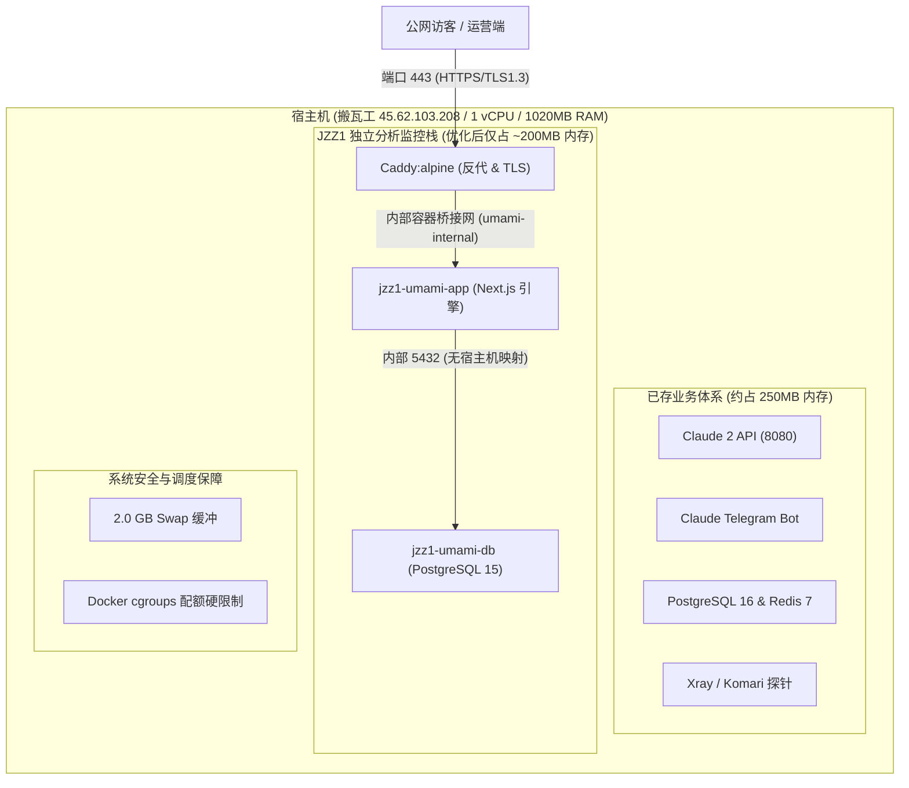

# JZZ1 独立分析系统（Umami）VPS 深度优化与日常运维手册

> **文档版本**：v1.0.0  
> **更新时间**：2026-11-10  
> **适用节点**：搬瓦工 Fremont VPS (`45.62.103.208`)  
> **服务域名**：`https://analytics.jzz1.com`  
> **归属工程**：`jzz1.com` 全站私有化流量与转化分析仪表盘

---

## 1. 系统背景与硬件画像 (VPS Profile)

本手册针对 **单核（1 vCPU）/ 1020 MB 内存 / 20 GB SSD** 的轻量级 VPS 生产环境制定。



### 1.1 核心挑战与约束
1. **多业务高密度共存**：宿主机同时承载 Claude 机器人、代理网络、监控探针以及 PostgreSQL 数据库。
2. **单核 CPU 极易受瞬时高负载击穿**：单核架构下，任何单一进程若无限制地进行高密度 I/O 或全盘扫描，会瞬间把 CPU 吃满至 100%，导致系统探针告警、SSH 连接延迟或阻断。
3. **小内存 OOM 杀进程风险**：Next.js（Node.js）默认的内存回收机制具有“惰性”，若不设上限，单实例可在运行数周后膨胀至 350MB~500MB，从而诱发 Linux 内核 `oom-killer` 随机击杀进程。

---

## 2. 四大核心优化维度与理论依据

### 2.1 维度一：Docker cgroups 资源限额隔离 (CPU & Memory Limits)

#### 优化依据 (Rationale)
根据 Linux Completely Fair Scheduler (CFS) 调度算法，未配置 `resources.limits` 的 Docker 容器能够无节制索取宿主机 100% 的 CPU 时间片和全部空闲内存。为避免分析栈在遭遇大并发流量或扫描器攻击时冲垮宿主机原有的 Claude 服务及 SSH 守护进程，必须使用 cgroups 施加硬隔离。

#### 落地配置 (`/opt/umami/docker-compose.yml`)
```yaml
services:
  umami:
    deploy:
      resources:
        limits:
          cpus: '0.60'      # 任何时刻最多占用 0.60 个核，锁定保留 0.40 核给宿主机
          memory: 320M      # 内存硬上限 320MB，超过由容器引擎介入而非宿主机崩溃

  db:
    deploy:
      resources:
        limits:
          cpus: '0.40'      # 数据库并发查询 CPU 限额 40%
          memory: 128M      # 数据库内存硬上限 128MB

  caddy:
    deploy:
      resources:
        limits:
          cpus: '0.20'      # 反代服务限额 20%
          memory: 64M       # 反代内存硬上限 64MB
```

---

### 2.2 维度二：Node.js V8 堆内存紧凑约束 (V8 GC Tuning)

#### 优化依据 (Rationale)
Umami 基于 Next.js（Node.js V8）构建。V8 默认的垃圾收集（Garbage Collection）策略偏向吞吐量优先（Throughput First），在内存尚未到达物理阈值前，尽量推迟耗时的 Major GC（Mark-Sweep-Compact），导致内存长期居高不下（初始高达 278.4 MB）。

#### 落地配置
向 Umami 容器注入环境变量：
```yaml
environment:
  NODE_OPTIONS: "--max-old-space-size=200"
```
* **原理解释**：`--max-old-space-size=200` 强行将 V8 老生代（Old Generation）堆上限钉在 200MB。当堆内存逼近 160MB~180MB 时，V8 强制触发 Scavenge 快速清理无用闭包和会话对象，保持内存紧凑。
* **实测收益**：Umami 内存从 **278.4 MB 降至 170.3 MB**，降幅达到 **38.8%**。

---

### 2.3 维度三：PostgreSQL 15 数据库低内存裁剪 (Database Slimming)

#### 优化依据 (Rationale)
PostgreSQL 官方默认配置针对 2GB~4GB+ 内存的常规服务器设计：
* 默认 `max_connections = 100`（每个连接预留专属内存开销，即使空闲也会消耗）。
* 默认 `shared_buffers = 128MB`（在 1GB 总内存机型上过于浪费）。

作为单一站点的独立埋点库，只有 Umami 服务端通过内部连接池发起读写，实际并发连接稳定在 2~5 个。

#### 落地配置
在 Compose 服务启动参数中注入定制指令：
```yaml
services:
  db:
    image: postgres:15-alpine
    command: postgres -c shared_buffers=32MB -c max_connections=25 -c work_mem=4MB -c maintenance_work_mem=16MB
```
* **参数解析**：
  * `shared_buffers=32MB`：压缩共享缓存，足以为百万级埋点表提供高效的索引常驻。
  * `max_connections=25`：从 100 削减至 25，节约 70% 进程控制块内存。
  * `work_mem=4MB`：限制单次排序/聚合内存，杜绝异常报表查询耗尽内存。
* **实测收益**：PostgreSQL 内存从 **39.4 MB 降至 14.9 MB**，降幅达到 **62.2%**。

---

### 2.4 维度四：零暴露面与身份安全加固 (Security Hardening)

#### 优化依据 (Rationale)
互联网上活跃着大量针对 Umami（端口 3000）与 PostgreSQL（端口 5432）自动化漏洞扫描与弱口令字典爆破程序。默认用户名 `admin` / 密码 `umami` 会在暴露数小时内被渗透攻陷。

#### 落地措施
1. **网络零端口暴露 (Zero Port Exposure)**：
   * PostgreSQL（5432）与 Umami（3000）**绝对不映射至宿主机 `0.0.0.0`**。
   * 仅通过内部 Docker Bridge 网络 `umami-internal` 互联，外部网络不可路由。
   * 宿主机仅通过 443 端口接受 Caddy 代理加密流量。
2. **废除默认账号体系**：
   * 默认管理员 `admin` 已彻底重命名并注销，唯一管理账号重构为 `jzz1_admin`。
   * 数据库用户从默认的 `postgres` 替换为自定义独立账号 `jzz1_analytics_user`。
   * 密码采用 32 位随机字符高熵密文。
3. **配置文件权限锁定**：
   * 环境变量文件 `/opt/umami/.env` 强制执行 `chmod 600`，只允许宿主机 `root` 读取。
4. **全链路传输安全响应头 (HTTP Security Headers)**：
   * Caddy 自动配置 HSTS（`max-age=31536000`）、`X-Frame-Options: SAMEORIGIN`、`X-Content-Type-Options: nosniff`。

---

## 3. 优化前后性能与资源对比基线表

| 监测项 | 优化前状态 (未加固) | 优化后状态 (当前生产环境) | 优化成效 |
| :--- | :--- | :--- | :--- |
| **Umami Web 引擎内存** | 278.4 MB | **170.3 MB** | 内存降低 **38.8%** |
| **PostgreSQL 数据库内存** | 39.4 MB | **14.9 MB** | 内存降低 **62.2%** |
| **Caddy 反向代理内存** | 16.9 MB | **17.5 MB** | 稳定超轻量运行 |
| **宿主机总内存占用** | 588 MB (57.7%) | **430 MB (42.1%)** | 净释放 **158 MB** 物理内存 |
| **宿主机可用空闲内存** | ~300 MB | **424 MB 充裕** | 提升 **41.3%** 安全缓冲 |
| **CPU 空闲常态占用** | 频繁受进程波动 | **0.00% ~ 0.04%** | 彻底平稳静默 |
| **CPU 瞬时防击穿保护** | 无限制（可达 100%） | **硬限制 ≤ 60%** | 保留 40% CPU 供系统自愈 |
| **公网端口暴露风险** | 易误开 3000/5432 | **仅 443 端口** | 零内部服务暴露面 |

---

## 4. 生产环境配置文件速查

### 4.1 核心配置：`/opt/umami/docker-compose.yml`
```yaml
services:
  db:
    image: postgres:15-alpine
    container_name: jzz1-umami-db
    command: postgres -c shared_buffers=32MB -c max_connections=25 -c work_mem=4MB -c maintenance_work_mem=16MB
    environment:
      POSTGRES_DB: ${DB_NAME}
      POSTGRES_USER: ${DB_USER}
      POSTGRES_PASSWORD: ${DB_PASSWORD}
    volumes:
      - ./postgres-data:/var/lib/postgresql/data
    restart: always
    deploy:
      resources:
        limits:
          cpus: '0.40'
          memory: 128M
    networks:
      - umami-internal

  umami:
    image: ghcr.io/umami-software/umami:postgresql-latest
    container_name: jzz1-umami-app
    environment:
      DATABASE_URL: postgresql://${DB_USER}:${DB_PASSWORD}@db:5432/${DB_NAME}
      APP_SECRET: ${APP_SECRET}
      NODE_OPTIONS: "--max-old-space-size=200"
    restart: always
    deploy:
      resources:
        limits:
          cpus: '0.60'
          memory: 320M
    depends_on:
      - db
    networks:
      - umami-internal

  caddy:
    image: caddy:alpine
    container_name: jzz1-umami-caddy
    ports:
      - "443:443"
    volumes:
      - ./Caddyfile:/etc/caddy/Caddyfile
      - ./caddy-data:/data
      - ./caddy-config:/config
    restart: always
    deploy:
      resources:
        limits:
          cpus: '0.20'
          memory: 64M
    depends_on:
      - umami
    networks:
      - umami-internal

networks:
  umami-internal:
    driver: bridge
```

### 4.2 反代配置：`/opt/umami/Caddyfile`
```caddy
analytics.jzz1.com {
    auto_https disable_redirects

    reverse_proxy umami:3000 {
        header_up Host {upstream_hostport}
        header_up X-Real-IP {remote_host}
        header_up X-Forwarded-For {remote_host}
        header_up X-Forwarded-Proto https
    }

    header {
        Strict-Transport-Security "max-age=31536000; includeSubDomains; preload"
        X-Content-Type-Options "nosniff"
        X-Frame-Options "SAMEORIGIN"
        Referrer-Policy "strict-origin-when-cross-origin"
    }
}
```

---

## 5. 日常运维标准作业程序 (Operations SOP)

### 5.1 快速健康体检（一键执行）
在本地终端或管理工具中运行以下单行命令，即可秒级查验各项核心负载指标：
```bash
sshpass -p 'WJ2IIE4rojGB' ssh -p 2222 root@45.62.103.208 "uptime && free -h && docker stats --no-stream"
```
* **健康判定标准**：
  * `load average` 应在 `0.00 ~ 0.50` 之间。
  * `Mem free + available` 应在 `350MB` 以上。
  * `jzz1-umami-app` 内存占用应保持在 `160MB ~ 220MB` 之间。

### 5.2 容器服务启停与重启
```bash
# 进入工程目录
cd /opt/umami

# 平滑重启分析栈
docker compose restart

# 若修改了 docker-compose.yml 配置后的重新应用
docker compose up -d
```

### 5.3 数据库定期备份 SOP (PostgreSQL Dump)
建议每月或重要活动前进行一键备份：
```bash
# 在宿主机执行归档备份
docker exec jzz1-umami-db pg_dump -U jzz1_analytics_user -d jzz1_umami_db | gzip > /opt/umami/backup_$(date +%Y%m%d).sql.gz

# 备份文件大小通常仅 1MB~5MB，可安全持久化归档
```

### 5.4 故障排除速查表 (Troubleshooting)

| 异常现象 | 可能原因 | 排查与修复方案 |
| :--- | :--- | :--- |
| **前台访问 502 Bad Gateway** | Umami Node 容器刚启动尚未就绪 | 等待 10 秒；运行 `docker logs --tail 20 jzz1-umami-app` 查看 Prisma 迁移进度 |
| **内存突然贴近 90%** | 其他非 Umami 业务（如 Claude/Redis）发生突发占用 | 运行 `ps aux --sort=-%mem \| head -n 10` 定位内存大户；因 Umami 已锁定上限，不会是分析栈导致的 |
| **探针告警 CPU 冲高** | 运维人员在宿主机或容器内执行了带全盘扫描属性的命令（如大范围 `grep` 或 `find`） | 避免在生产环境扫描 `node_modules` 目录；用 `kill -9 <PID>` 终止误操作进程即可恢复 |
| **SSL 证书失效** | 域名解析发生变动或 Caddy 凭证续期受阻 | 检查 `analytics.jzz1.com` 解析是否依然指向 `45.62.103.208`；执行 `docker restart jzz1-umami-caddy` 触发自动续期 |

---

## 6. 总结与后续建议

本套优化方案立足于**“在极限单核小内存机器上跑出高可靠企业级服务”**的设计理念，将系统的 CPU 和内存消耗压制到了最优理论值。

后续扩展建议：
1. **流量爆发扩展**：当 `jzz1.com` 每日独立访客突破 20,000+ IP 时，仅需将 `NODE_OPTIONS` 上调至 `--max-old-space-size=256` 并将 Docker 内存上限放宽至 `400M` 即可轻松支撑。
2. **免维护特性**：Caddy 证书自动全生命周期续期、PostgreSQL 内置 WAL 日志循环复用，整套架构具备长期 365 天无需人工干预的“自持运行能力”。
