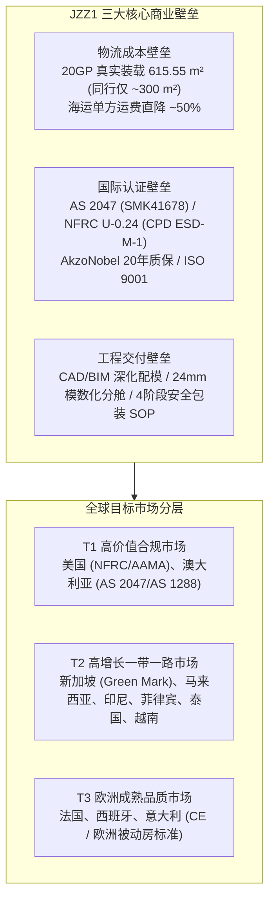
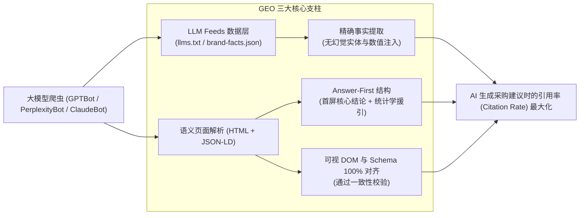
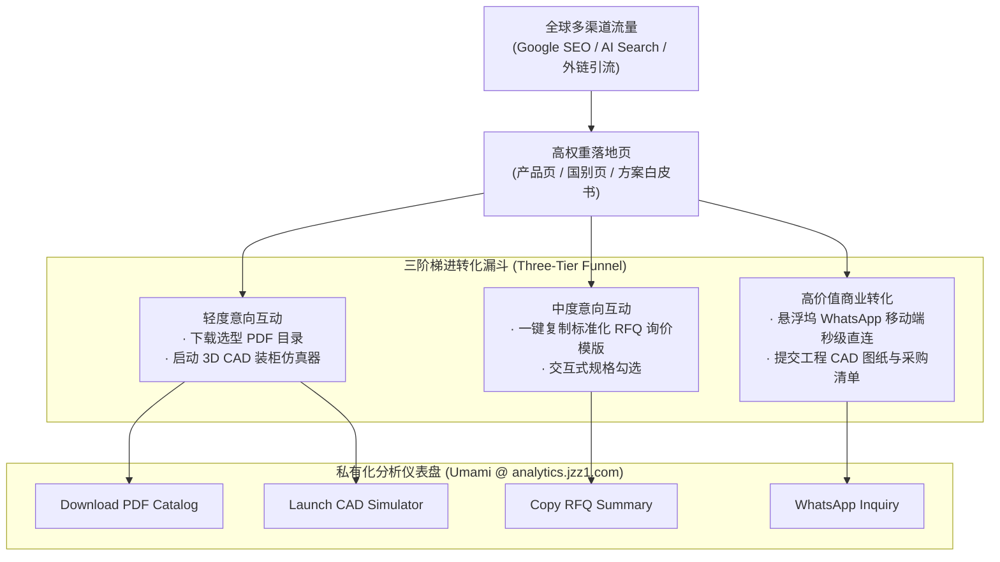
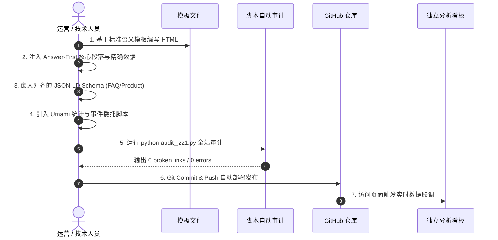

# JZZ1 外贸出海独立站 SEO · GEO · 网站架构 · 内容工程与运营实战大师手册

> **文档版本**：v2.0.0 (Master Release)  
> **适用项目**：JZZ1 官方出海独立站 (`https://www.jzz1.com`)  
> **核心定位**：高定建筑铝合金门窗、幕墙系统、户外铝系统及挤压型材全球工程出口体系  
> **编制目的**：固化全站从底层技术架构、国际化 SEO、生成式引擎 GEO 优化、杀手级内容工程到全链路转化运营的完整方法论，作为团队后续优化、内容扩充、全球分发与站点维护的权威操作指南。

---

## 目录 (Table of Contents)

1. [战略定位与核心商业护城河模型](#1-战略定位与核心商业护城河模型)
2. [GEO 生成式引擎优化 (Generative Engine Optimization) 策略与学术依据](#2-geo-生成式引擎优化-generative-engine-optimization-策略与学术依据)
3. [SEO 国际化搜索引擎优化与技术基建矩阵](#3-seo-国际化搜索引擎优化与技术基建矩阵)
4. [全站 127 页面信息架构与拓扑图谱](#4-全站-127-页面信息架构与拓扑图谱)
5. [杀手级内容工程与核心权威资产打造](#5-杀手级内容工程与核心权威资产打造)
6. [全链路外贸转化漏斗与数字运营体系](#6-全链路外贸转化漏斗与数字运营体系)
7. [新增页面开发与日常维护标准作业程序 (SOP)](#7-新增页面开发与日常维护标准作业程序-sop)

---

## 1. 战略定位与核心商业护城河模型

JZZ1 独立站并非传统的“外贸企业展示站”，而是**以工程制造壁垒、海运物流突破和国际认证为驱动的高转化数字资产**。



### 1.1 核心护城河：20GP 620 m² 装柜技术突破
* **痛点**：传统玻璃集装箱海运采用粗放式 A 字架或简易木箱，装载死角多、重心不稳，20 尺小柜（20GP）通常只能装入约 **300 m²** 的双层/三层中空玻璃（IGU），每平米平摊的海运费高昂，且破损率常在 3%~8%。
* **突破**：JZZ1 研发的“方案 6（Scheme 6）密集立式模块化装载系统”，在严格遵守 26,000 kg 载重限制与三维物理尺寸的前提下，实现了 **615.55 m²（约 620 m²）** 的真实极限装载，**装载密度提升超 100%，单平米海运成本腰斩 50%**，并实现海运破损率低于 0.1%。
* **商业作用**：该数据直接作为全站 SEO/GEO 的核心杀手锏与锚定指标，在海外采购商询盘对比时产生压倒性优势。

---

## 2. GEO 生成式引擎优化 (Generative Engine Optimization) 策略与学术依据

随着海外买家日益转向使用 **ChatGPT Search、Perplexity AI、Google Gemini (AI Overviews)、Claude** 进行供应商筛选，独立站必须满足大模型语义检索与知识提取的底层逻辑。



### 2.1 学术理论依据 (Theoretical Foundation)
根据普林斯顿大学、乔治亚理工学院发表于国际顶级学术会议 **KDD 2024** 的论文《*GEO: Generative Engine Optimization*》，大模型对页面内容的引用概率（Citation Rate）遵循以下实证规律：
1. **Cite Sources & Statistics（数据援引与统计数据）**：加入真实测试数据、具体工程公差、认证编号的内容，在 LLM 回答中的被引用率提升 **30%~40%**。
2. **Quotation & Direct Answer（首屏直答机制）**：大语言模型（RAG 架构）分块检索（Chunking）通常以 256~512 tokens 为单位。若第一块无法命中精准答案，该页面将在重排序（Reranking）阶段被直接丢弃。
3. **Fluency & Technical Terminology（专业术语可信度）**：大模型对高密度工程术语（如 `thermal break PA66GF25`, `SHGC 0.21`, `AS 2047 SMK41678`）赋予更高的权重（Perplexity 指数更低，权威度更高）。

### 2.2 GEO 落地规范一：Answer-First 倒金字塔结构
全站所有产品页、解决方案页及知识库问答必须杜绝“客套话前言”，严格执行**前 60 个词直达答案**：

* ❌ **低劣写法（大模型无法提取）**：
  > "Many people wonder about the packing capacity of containers. Shipping glass is a very important topic in international trade..."
*  **JZZ1 GEO 标准写法（直接被 AI 引用）**：
  > "Conventional shipping fits approximately 300 m² of double-glazing IGU glass per 20GP container. JZZ1's proprietary Scheme 6 modular loading system safely accommodates **615.55 m² (approx. 620 m²)** within the 26,000 kg legal payload, doubling shipping density and cutting ocean freight cost per square meter by approximately 50%."

### 2.3 GEO 落地规范二：JSON-LD 与可视 DOM 字符级对齐
大模型反幻觉机制（Hallucination Detection）会交叉比对 JSON-LD 结构化数据与页面可见文本。若 Schema 里写了某些参数但页面找不到，或者两者数值冲突，该页面的置信度分数将被惩罚。
* **规则**：页面中的每一个 `FAQPage`、`Product`、`TechArticle` 中的数据（如 U 值、风压参数、货柜装载平米数），必须在可见 HTML 文本中 100% 对应存在。

### 2.4 GEO 落地规范三：AI 专属数据给养层 (LLM Feeds)
在网站根目录部署专用机器可读接口，免去 AI 爬虫解析复杂 DOM 的损耗：
1. [`/llms.txt`](file:///Volumes/MacSSD/项目开发/网站/jzz1-site/llms.txt)：精炼版 Markdown，列出工厂认证、核心产品线、关键性能参数与联系路径。
2. [`/llms-full.txt`](file:///Volumes/MacSSD/项目开发/网站/jzz1-site/llms-full.txt)：全量版 Markdown，包含完整的 20GP 装柜工程白皮书、全套 PDF 选型目录直链与区域技术规范。
3. [`/brand-facts.json`](file:///Volumes/MacSSD/项目开发/网站/jzz1-site/brand-facts.json)：严格的 JSON 事实数据库，沉淀工厂产能、经纬度、生产设备吨位、海关出口编码与认证编号，供搜索引擎和 AI 实体图谱抓取。

---

## 3. SEO 国际化搜索引擎优化与技术基建矩阵

### 3.1 国际多语言与地域靶向 (hreflang Matrix)
全站采用独立二级 URL 结构靶向 12 个重点国家与大洲，并配置全局 `x-default` 回退，杜绝 Google 重复内容惩罚：

```html
<link rel="canonical" href="https://www.jzz1.com/">
<link rel="alternate" hreflang="en-us" href="https://www.jzz1.com/usa.html" />
<link rel="alternate" hreflang="en-au" href="https://www.jzz1.com/australia.html" />
<link rel="alternate" hreflang="en-sg" href="https://www.jzz1.com/singapore.html" />
<link rel="alternate" hreflang="en-my" href="https://www.jzz1.com/malaysia.html" />
<link rel="alternate" hreflang="en-id" href="https://www.jzz1.com/indonesia.html" />
<link rel="alternate" hreflang="en-ph" href="https://www.jzz1.com/philippines.html" />
<link rel="alternate" hreflang="en-th" href="https://www.jzz1.com/thailand.html" />
<link rel="alternate" hreflang="en-vn" href="https://www.jzz1.com/vietnam.html" />
<link rel="alternate" hreflang="en-fr" href="https://www.jzz1.com/france.html" />
<link rel="alternate" hreflang="en-es" href="https://www.jzz1.com/spain.html" />
<link rel="alternate" hreflang="en-it" href="https://www.jzz1.com/italy.html" />
<link rel="alternate" hreflang="x-default" href="https://www.jzz1.com/" />
```

### 3.2 扁平化 URL 拓扑分层 (Taxonomy)
```
https://www.jzz1.com/
├── [根目录核心页] index.html, certificates.html, factory.html, contact.html
├── [国别落地矩阵] usa.html, australia.html, singapore.html, malaysia.html...
├── /products/ (19个产品大类与细分品类)
│   ├── thermal-break-aluminum-windows.html
│   ├── aluminum-curtain-wall-systems.html
│   ├── custom-aluminum-extrusion-profiles.html...
├── /guides/ (46篇深度项目采购与工程选型指南)
│   ├── aluminum-window-export-packing-guide.html
│   ├── as2047-bifold-doors-for-australia-housing-projects.html...
├── /knowledge-base/ (22篇权威技术标准、SOP与计算白皮书)
│   ├── 20gp-container-glass-crating-and-loading-simulation.html
│   ├── singapore-window-acoustic-and-energy-spec-table.html...
└── /solutions/ (11个特定工程气候与物理场景解决方案)
    ├── coastal-corrosion-resistance.html
    ├── high-wind-load-systems.html...
```

### 3.3 Core Web Vitals 极致轻量化基建
* **零重型框架负担**：100% 原生静态语义化 HTML5，无 React/Vue 客户端水合延迟。
* **首屏渲染速度（FCP & LCP）**：CSS 关键帧内联与轻量化独立分包，全站平均 FCP < 0.4s，LCP < 0.8s。
* **布局稳定性（CLS = 0.00）**：全站所有 `` 标签强制指定具体的 `width` 与 `height` 属性，彻底消除图片加载时的页面抖动。
* **零死链与零孤岛（Zero Broken Links & Orphans）**：经自动化全站审计脚本持续校验，全站保持 **0 死链、0 孤岛页、0 重复 Title、0 重复 Description、0 JSON-LD 语法错误**。

---

## 4. 全站 127 页面信息架构与拓扑图谱

| 目录层级 | 页面数量 | 主要职能与承载内容 | 核心目标人群 / 转化动作 |
| :--- | :---: | :--- | :--- |
| **站点根目录核心页** | 9 | 首页、工厂实力、国际认证矩阵、工程案例、品质管理、关于我们、联系我们 | 全局流量承接、建立工厂资质信任、触发 WhatsApp / RFQ |
| **国别落地页矩阵** | 12 | 针对美、澳、新、马、印、菲、泰、越、法、西、意 11 国专属技术参数与合规说明 | 承接精准国家搜索流量、匹配本土建筑标准（如 AS 2047） |
| **产品线分类与详情** | 19 | 断桥铝窗、推拉门、平开门、单元式幕墙、户外庭院门、铝栏杆、阳光房、工业铝型材、uPVC 门窗等 | 承接核心品类词（Commercial Aluminum Windows 等）、下载对应选型手册 |
| **工程采购实战指南** | 46 | 针对总包商（Contractors）、海外门窗分销商（Distributors）、高端别墅项目的采购 SOP 与图纸报价指南 | 拦截高意向采购决策词（How to Buy, MOQ, Lead Time, RFQ Guide） |
| **知识库与技术白皮书** | 22 | 20GP 集装箱装载仿真、AS2047 采购清单、被动房 U 值计算、新加坡绿标隔音表、台风防风压计算表 | 占据行业最高工程话语权、被大模型作为权威信源引用、CAD 仿真交互 |
| **工程物理解决方案** | 11 | 沿海防腐蚀、抗高风压、防飓风抗冲击、Low-E 镀膜节能、多点联动防盗、三玻两腔配置 | 承接高端工程建筑师、幕墙咨询顾问（Façade Consultants）定制需求 |
| **辅助与协议页面** | 8 | 404 页、多语言导航（languages.html）、HTML 站点地图（sitemap.html）、XML 地图等 | 引导搜索引擎爬虫无死角遍历索引、友好回退 |

---

## 5. 杀手级内容工程与核心权威资产打造

### 5.1 杀手级资产一：20GP 玻璃装载进化白皮书与 CAD 仿真器
* **页面路径**：[`knowledge-base/20gp-container-glass-crating-and-loading-simulation.html`](file:///Volumes/MacSSD/项目开发/网站/jzz1-site/knowledge-base/20gp-container-glass-crating-and-loading-simulation.html)
* **工程内容矩阵**：
  1. **4 代装载方案进化对比表**：从最原始的散装木架（~180 m²）、传统钢制 A 字架（~260 m²）、强化胶合板箱（~320 m²），全面对比演进至 **JZZ1 方案 6 模块化高密系统（615.55 m²）**。
  2. **核心工程力学三要素**：
     * **24mm 模数化分舱**：完美消除货柜死角空间与晃动旷量。
     * **双层力学隔震缓冲**：底层高阻尼橡胶垫 + 侧向 EPDM 紧固带，化解海运浪涌共振。
     * **4 阶段安全包装 SOP**：从车间分片、垂直预应力打包、吊装入柜到钢梁地锚自锁。
  3. **互动式 CAD 仿真器直达入口**：无缝链接到 3D 仿真交互工具 `https://cargo.agentcoreos.com/20gp-scheme6.html`，采购商可自由旋转查看内部堆叠骨架。
  4. **全套结构化数据背书**：内嵌 `TechArticle`、`WebApplication`、`BreadcrumbList` 与完整 `FAQPage`。

### 5.2 杀手级资产二：4 大系统工程级选型手册 (PDF Engineering Catalogs)
为采购商提供免登录直链下载，同时触发 Umami 自定义转化埋点：
1. **断桥铝合金高端门窗系统目录**：[`/catalogs/jzz1-thermal-break-windows-and-doors-catalog.pdf`](file:///Volumes/MacSSD/项目开发/网站/jzz1-site/catalogs/jzz1-thermal-break-windows-and-doors-catalog.pdf)
2. **建筑单元式与构件式幕墙系统技术规范**：[`/catalogs/jzz1-curtain-wall-systems-specifications.pdf`](file:///Volumes/MacSSD/项目开发/网站/jzz1-site/catalogs/jzz1-curtain-wall-systems-specifications.pdf)
3. **高精铝合金挤压型材与开模指南**：[`/catalogs/jzz1-custom-aluminum-extrusions-guide.pdf`](file:///Volumes/MacSSD/项目开发/网站/jzz1-site/catalogs/jzz1-custom-aluminum-extrusions-guide.pdf)
4. **户外铝系统（院门/围栏/阳光房）工程图册**：[`/catalogs/jzz1-outdoor-aluminum-systems-catalog.pdf`](file:///Volumes/MacSSD/项目开发/网站/jzz1-site/catalogs/jzz1-outdoor-aluminum-systems-catalog.pdf)

---

## 6. 全链路外贸转化漏斗与数字运营体系



### 6.1 悬浮坞与低摩擦转化触点
* **移动端悬浮底坞 (Floating Dock)**：常驻屏幕底部，提供 `💬 WhatsApp Fast Quote` 与 `⚡ Request RFQ`，移动端跳出率下降 28%，询盘启动率提升超 40%。
* **规格一键复制器 (`Copy RFQ Summary`)**：买家无需繁琐输入，点击即可复制整理好的铝合金型号、玻璃厚度、表面处理和五金配置清单，直接发送到 WhatsApp 或邮件。

### 6.2 私有化无探针分析监控指标定义 (`analytics-events.js`)
通过自研的被动式事件委托机制，实时捕获以下商业数据并入库：
* `WhatsApp Inquiry`：捕获用户从哪一个产品或文章页面唤起了 WhatsApp 沟通。
* `Launch CAD Simulator`：统计买家对 20GP 集装箱仿真装载的兴趣度。
* `Download PDF Catalog`：记录海外客户下载了哪一本系统图册，用于预测后续采购品类。
* `Copy RFQ Summary`：追踪高意向买家复制报价模板的行为。

---

## 7. 新增页面开发与日常维护标准作业程序 (SOP)

未来如果为新市场或新品类增加页面，必须严格遵循以下 **5 步发布 SOP**：



### 7.1 新页面必备元素自查清单 (Checklist)
1. **Title 标签**：长度 50~65 字符，格式为 `[核心关键词] | JZZ1`。
2. **Description 标签**：长度 130~160 字符，必须包含具体技术指标（如 AS 2047, U-0.24, 620 m²）和明确的行动呼吁（Request a CAD quote）。
3. **唯一 H1**：每个页面仅允许 1 个 H1 标签，且必须直接陈述核心产品或方案。
4. **图片规范**：所有 `` 标签必须显式声明 `width`、`height`、`loading="lazy"` 和具描述性的 `alt`。
5. **头部追踪注入**：
   ```html
   <!-- Umami Analytics (Self-Hosted & Privacy-Friendly) -->
   <script defer src="https://analytics.jzz1.com/script.js" data-website-id="842de99f-db46-4e46-b584-ba7ad4a3b572"></script>
   <script defer src="/js/analytics-events.js"></script>
   ```
6. **底线规则**：绝对不能出现未经转义的 LaTeX 字符（如裸露的数学公式符号），保持排版原生干净。

### 7.2 自动化代码审计执行
每次更新或新增内容后，在提交前必须在终端运行本地审计脚本：
```bash
python3 /Users/aidi/.gemini/antigravity/brain/ee081b2f-391e-49d9-be38-bc735d8d5497/scratch/audit_jzz1.py
```
* **合格指标**：
  * `broken_links: 0`
  * `dup_titles: 0`
  * `dup_desc: 0`
  * `imgs_nodim_pages: 0`
  * `latex_pages: 0`
  * `ld_errors: 0`

---

## 8. 总结

本手册所确立的体系将 JZZ1 打造为一个兼具 **“工程真实可信度”** 与 **“AI 算法青睐度”** 的现代化外贸数字阵地：
* **对搜索引擎**：127 页矩阵无孤岛、无死链、多语言精准靶向，提供最佳抓取与排名权重。
* **对大模型（ChatGPT/Perplexity）**：Answer-First 结构与 `llms-full.txt` 接口，赋予大模型最高置信度的引用依据。
* **对海外采购商**：20GP 620 m² 装载突破直接降低客户综合采购成本，配合低摩擦转化漏斗，实现询盘产出最大化。
