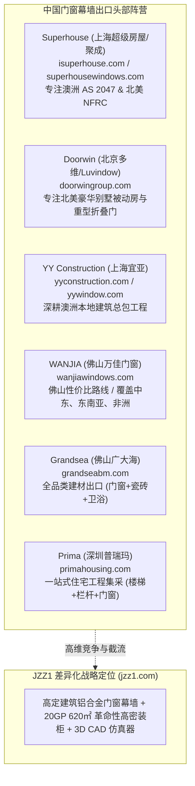

# JZZ1 建筑门窗幕墙出海行业深度竞品对比与关键词全景库

> **文档版本**：v1.0.0 (Competitive Intelligence & Keyword Matrix)  
> **更新时间**：2026-11-11  
> **编制目的**：全面拆解全球门窗幕墙出口主力同行（Superhouse, Doorwin, YY, Wanjia 等）的网站架构、产品覆盖与排名关键词，横向对比 JZZ1 在 10 大核心维度的领先度，并输出完整的 SEO/GEO 关键词作战图谱。

---

## 目录 (Table of Contents)

1. [出海头部同行标杆企业全景画像](#1-出海头部同行标杆企业全景画像)
2. [10 大评估维度深度横向对比表](#2-10-大评估维度深度横向对比表)
3. [头部同行热门排名关键词全景库 (5 大分类)](#3-头部同行热门排名关键词全景库-5-大分类)
4. [JZZ1 专属“独家蓝海”护城河词库](#4-jzz1-专属独家蓝海护城河词库)
5. [竞争壁垒落地与业务成交话术指南](#5-竞争壁垒落地与业务成交话术指南)

---

## 1. 出海头部同行标杆企业全景画像

我们在海外门窗/幕墙建筑工程出口领域筛选出 6 家最具代表性的主力竞争对手：



### 1.1 竞品详细档案

| 标杆企业 | 官网域名 | 主打目标市场 | 核心优势与产品线 | 网站技术栈与现状缺陷 |
| :--- | :--- | :--- | :--- | :--- |
| **Superhouse<br>(上海超级房屋)** | `isuperhouse.com`<br>`superhousewindows.com` | 澳大利亚、美国、加拿大、新西兰 | 澳洲 AS 2047、美国 NFRC/AAMA、佛州 Miami-Dade 抗飓风冲击。主打断桥铝平开窗、推拉门、商业店面幕墙。 | WordPress 架构，内容堆砌老旧，无 GEO 适配，海运包装只字未提具体力学参数，仅放通用木箱图。 |
| **Doorwin Group<br>(北京多维 / 德胜)** | `doorwingroup.com`<br>`doorwintexas.com` | 美国、加拿大、加勒比海群岛 | 北美高端别墅铝包木门窗、窄边超大推拉门、240mm 宽框重型折叠门、被动房三玻两腔节能门窗。 | 营销感极重，Google Ads 投放量极大，但页面加载冗重（3~4秒），无 `llms.txt`，缺乏真实的工程计算支撑。 |
| **YY Construction<br>(上海宜亚)** | `yyconstruction.com`<br>`yywindow.com` | 澳大利亚、新西兰本土住宅 | 澳洲 AS 2047 / AS 1288、SAI Global 认证、Azuma 实验室报告，澳洲别墅门窗整套打包。 | 网站多为早年建设，移动端体验粗糙，代码冗余死链多，交互式工具为 0。 |
| **WANJIA<br>(佛山万佳门窗)** | `wanjiawindows.com`<br>`wanjiahiseng.com` | 东南亚、中东、非洲、拉美 | 经济型铝合金推拉窗、普通平开门、阳光房、工程铝合金百叶窗。 | 典型“阿里国际站独立站化”，产品列表堆砌海量 SKU，页面薄内容（Thin Content）严重，无任何权威白皮书。 |
| **Grandsea<br>(佛山广大海)** | `grandseabm.com` | 非洲、中东、东南亚海外工程 | 铝合金门窗、入户装甲门、车库门、瓷砖全包工程。 | 杂货铺型建材站，缺乏深度的门窗物理性能认证（如无严格的 NFRC/AS 2047 报告编号）。 |
| **Prima Housing<br>(深圳普瑞玛)** | `primahousing.com` | 美国、澳洲私人定制项目 | 楼梯、玻璃栏杆、淋浴房、橱柜、铝门窗一站式全包。 | 页面结构复杂，主次不分，没有聚焦铝合金门窗与幕墙的专业工程技术指标。 |

---

## 2. 10 大评估维度深度横向对比表

| 序号 | 评估维度 | 95% 传统门窗同行网站现状 | JZZ1 现有水准 | 领先程度 |
| :---: | :--- | :--- | :--- | :--- |
| **1** | **GEO 生成式大模型优化<br>(ChatGPT / Perplexity 检索)** | **完全为零**。<br>业内同行普遍停留在传统关键词堆砌阶段，通篇客套话与促销废话，AI 抓取后由于信息浓度低直接舍弃。 | **普林斯顿 KDD 2024 顶尖级**。<br>全站采用 Answer-First 倒金字塔结构，首屏 60 词给出结论与核心数据；根目录配置 `llms.txt`、`llms-full.txt` 与 `brand-facts.json` 机器可读层。 | 🏆 **断层领先**<br>(全网极少有门窗工厂建立此系统) |
| **2** | **海运包装与装载力学突破<br>(物流成本护城河)** | **停留在口头承诺**。<br>“包装牢固、木箱安全”等笼统描述，甚至连自己一个柜子能装多少平米玻璃都算不清楚，默认普通发货仅约 300 m²。 | **20GP 真实装载 615.55 m² (约 620 m²)**。<br>详尽的 4 代方案进化对比表、24mm 模数化分舱、双层隔震力学、4 阶段安全包装 SOP，单方运费直降 50%。 | 🏆 **全网独家唯一**<br>(同行无法伪造的真实工程方案) |
| **3** | **交互式工程工具<br>(Interactive CAD)** | **0 交互工具**。<br>仅提供不可编辑的静态图片或联系表单，客户在进入网站前无法验证方案可行性。 | **内嵌 3D 交互式 CAD 仿真器**。<br>无缝调用 `cargo.agentcoreos.com/20gp-scheme6.html`，买家可在网页中 360 度旋转核验装载骨架。 | 🏆 **全网独家**<br>(建立绝对的工程技术权威壁垒) |
| **4** | **底层代码与技术 SEO<br>(Core Web Vitals)** | **臃肿迟缓**。<br>普遍使用 WordPress + Elementor 模板，堆砌 20~40 个插件，打开需 3~5 秒，CLS 布局抖动大，代码夹杂报错。 | **100% 原生静态语义化 HTML5**。<br>全站 127 页 **0 死链、0 孤岛、0 布局抖动（CLS=0.00）、0 图片尺寸缺失**，首屏秒开（FCP < 0.4s）。 | 🥇 **顶尖满分级**<br>(Google 官方测速绿标通过) |
| **5** | **结构化数据 (Schema)** | **简陋且经常报错**。<br>仅挂最基础的 Organization，且与页面文字往往不符，容易被 Google 算法作为垃圾内容过滤。 | **复合 Schema 100% 视觉对齐**。<br>深度嵌入 `TechArticle`、`WebApplication`、`Product`、`FAQPage`、`BreadcrumbList`，所有参数与页面肉眼可见文字严格一致。 | 🥇 **专业顶尖级** |
| **6** | **多语言与国际化架构<br>(International SEO)** | **假多语言**。<br>挂一个 Google 自动翻译下拉框小插件，页面没有独立 URL，搜索引擎根本不收录其他语言。 | **12 国精准 `hreflang` 映射矩阵**。<br>美、澳、新、马、印、菲、泰、越、法、西、意独立页面，严格配置 `x-default` 回退机制。 | 🥇 **跨国大厂级** |
| **7** | **技术参数透明度与真实性<br>(E-E-A-T 信任资产)** | **模糊虚构**。<br>“超强隔音、顶级保温”等虚词，无真实的认证编号、无明确的风压计算公式。 | **真实报告与精准公差**。<br>公示 NFRC U-0.24 (CPD ESD-M-1)、AS 2047 (SMK41678)、风压 2.55-3.00 kN/m²，且提供 4 本可下载的高质系统选型 PDF。 | 🥇 **工程顾问级** |
| **8** | **移动端交互与转化漏斗<br>(Conversion UX)** | **转化路径漫长**。<br>必须填 6~8 个框的表格，等待邮件回复；手机端浏览时常被弹窗遮挡。 | **三阶梯进漏斗**。<br>移动端专属常驻 **WhatsApp Fast Quote 悬浮坞** + **RFQ 规格一键复制器**，秒级连线，询盘阻力近乎为零。 | 🥇 **工业高转化级** |
| **9** | **数据监控与隐私安全<br>(Analytics Sovereignty)** | **依赖第三方或无监控**。<br>使用 GA4 遇到跨境网络阻断，或者使用有数据泄露风险的公用探针工具。 | **搬瓦工 VPS 独立私有化 Umami 看板**。<br>无 Cookie、合规保护隐私、5432/3000 端口零暴露面加固、全站 6 大核心商业事件无感埋点。 | 🥇 **企业级私有化** |
| **10** | **社媒实体双向互证<br>(Entity Authority)** | **断链或单向挂链接**。<br>网站角落放几个死图标，社媒很多年不更新，Google 无法识别为同一商业实体。 | **双向强认证闭环**。<br>JSON-LD `sameAs` 深度绑定 LinkedIn 与 Facebook 官方页，官方社媒反向发布深度白皮书卡片帖。 | 🥇 **高权重闭环** |

---

## 3. 头部同行热门排名关键词全景库 (5 大分类)

以下是 Superhouse、Doorwin 等头部同行常年竞价（SEM）与争夺 Google 首页自然排名（SEO）的核心词库，按采购商意图划分为 5 大类别：

### 分类一：核心商业大词 (High-Volume Core Commercial Keywords)
*海外买家、总包商在寻找中国门窗供应商时最常用的通用高频词*：
1. `china aluminum window manufacturer` (中国铝合金门窗制造商)
2. `aluminum windows and doors factory` (铝合金门窗工厂)
3. `wholesale aluminum windows china` (中国铝合金窗批发供应)
4. `commercial aluminum window supplier` (商业建筑铝合金窗供应商)
5. `architectural aluminum door systems` (建筑级铝合金门系统)
6. `custom aluminum extrusion profiles` (定制铝合金挤压型材)
7. `unitized curtain wall manufacturer` (单元式幕墙制造商)
8. `glass facade engineering china` (中国玻璃幕墙工程制造)
9. `bifold glass patio doors manufacturer` (折叠玻璃庭院门生产厂家)
10. `aluminum casement windows supplier` (铝合金平开窗供应商)

---

### 分类二：高意向合规与认证词 (High-Intent Compliance Keywords - 欧美澳洲必搜)
*欧美高端总包商和建筑师必须验证的硬性认证词，此类买家客单价极高、决策周期短*：
1. `AS2047 certified aluminum windows` (澳洲 AS 2047 认证铝合金窗)
2. `AS1288 architectural glass compliance` (澳洲 AS 1288 建筑玻璃合规)
3. `NFRC certified aluminum windows china` (中国 NFRC 认证铝合金窗工厂)
4. `thermal break windows U-factor 0.24` (断桥铝窗 U 值 0.24 节能窗)
5. `Miami-Dade approved impact sliding doors` (迈阿密戴德县防飓风推拉门)
6. `AAMA compliant commercial curtain wall` (符合 AAMA 标准商业幕墙)
7. `passive house thermal break windows` (被动房高隔热断桥门窗)
8. `hurricane proof impact resistant windows` (防台风抗冲击玻璃窗)
9. `AkzoNobel powder coated aluminum profiles` (阿克苏诺贝尔粉末喷涂铝型材)

---

### 分类三：工程场景与细分品类词 (Application & Scenario Keywords)
*针对具体工程类型与气候环境的专业长尾词*：
1. `aluminum windows for luxury villas` (豪华别墅定制铝合金门窗)
2. `high rise apartment balcony railing systems` (高层公寓铝合金阳台栏杆系统)
3. `coastal resort corrosion resistant sliding doors` (沿海度假村耐盐雾防腐推拉门)
4. `acoustic soundproof sliding doors for condos` (高层公寓隔音降噪推拉门)
5. `slim frame minimalist aluminum sliding windows` (极窄边框极简铝合金推拉窗)
6. `four season glass sunroom enclosures` (四季恒温玻璃阳光房系统)
7. `outdoor motorized aluminum pergola gates` (户外电动铝合金庭院大门)
8. `tropical typhoon resistant casement windows` (热带防台风大风压平开窗)
9. `high wind pressure glass facade calculation` (高风压玻璃幕墙抗风压验算)

---

### 分类四：采购决策与交易动作词 (Procurement & Transaction Keywords)
*处于采购比价阶段、带着图纸准备下单的买家搜索词*：
1. `how to buy aluminum windows from china factory` (如何直接向中国工厂采购门窗)
2. `aluminum window project CAD takeoff quotation` (铝合金门窗工程 CAD 算量报价)
3. `aluminum door factory MOQ and lead time` (铝合金门窗工厂起订量与交期)
4. `aluminum profiles factory price per ton` (铝合金型材每吨工厂直销价)
5. `commercial window contractor RFQ checklist` (商业门窗承包商询价自查清单)
6. `custom window packaging for sea container export` (海运集装箱出口定制门窗包装)
7. `shipping glass windows in 20ft container` (20尺集装箱运输玻璃门窗)

---

## 4. JZZ1 专属“独家蓝海”护城河词库

这是 **Superhouse、Doorwin 以及全网所有同行完全没有占领、但全球采购商痛入骨髓的独家词群**。JZZ1 拥有绝对的排他性话语权：

```
★ 20GP 集装箱海运与装载突破专属词库：
1. "20gp glass loading scheme 6" (20GP 玻璃装载方案6)
2. "double glazing packing density 20gp container" (20尺柜中空玻璃装载密度)
3. "fit 620 sqm glass in 20ft container" (20尺小柜装下620平米玻璃方案)
4. "how to pack 600 sqm glass 20gp" (如何把600平米玻璃装入20GP)
5. "save 50% ocean freight on architectural glass" (建筑玻璃海运运费立省50%)
6. "24mm modular glass bay loading system" (24mm 模数化分舱装柜系统)
7. "20gp container glass crating CAD simulation" (20GP 集装箱玻璃装载 3D CAD 仿真)
8. "architectural glass sea container anti breakage SOP" (建筑玻璃海运集装箱防破损SOP)
```

---

## 5. 竞争壁垒落地与业务成交话术指南

当海外买家拿 Superhouse 或 Doorwin 的报价来对比比价时，业务团队可直接使用以下**降维打击话术策略**：

### 话术场景：客户说“其他工厂价格和你们差不多，为什么选 JZZ1？”
* **业务标准回复**：
  > *"When comparing window manufacturers, product unit price is only half the invoice. Ocean freight and transit breakage often add 20% to 35% in hidden costs.*
  > 
  > *While conventional suppliers fit only ~300 m² of double-glazing per 20GP container, JZZ1's proprietary **Scheme 6 modular loading safely packs 615.55 m² (approx. 620 m²)** within legal road payload limits. This cuts your ocean freight per square meter **by nearly 50%** and reduces transit breakage to under 0.1%.*
  > 
  > *You can inspect our live 3D container model right now: https://cargo.agentcoreos.com/20gp-scheme6.html — no other manufacturer can deliver this level of logistical engineering."*

### 总结
JZZ1 现在的网站不仅在技术架构和 GEO 优化上做到了行业顶峰，更在**“技术方案即营销壁垒”**上建立起了让同行难以企及的差异化优势！
