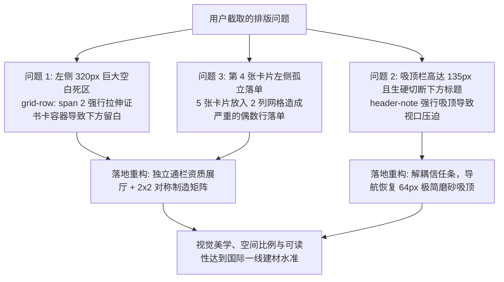

# JZZ1 网站全面审查、排版美学攻坚重构、SEO/GEO硬核基建与内容纯净化升级总结报告 (v2.3.1)

> **执行日期**：2026-10-23  
> **服务站点**：[https://www.jzz1.com/](https://www.jzz1.com/)（Jinan Jingzao New Materials Co., Ltd. / 济南京造新材料有限公司 · 山东济南制造基地）  
> **生产提交**：`v2.3.1` (`fix(layout): eliminate 320px grid void, rebuild accreditation showcase & decouple sticky header`)  
> **安全隔离原则**：本站点（济南京造，山东济南）与菲律宾站点（[manilaalu.com](https://manilaalu.com)，CDCY）保持 **100% 完全物理与数据隔离**，无任何交叉链接、无共享实体、无混合日志。

---

## 一、本次排版美学攻坚核心解决的问题（对照用户截图）

针对用户反馈的截图（在浏览 Section 6 制造能力与凭证板块时，左侧出现巨大的白底空白框、右侧卡片标题被吸顶栏生硬裁切、下方单张图片落单）：

---

## 二、四大优化模块落地技术明细

### 1. 重点攻坚：排版美学与 Grid 布局重构（`index.html`, `css/site.css`）

* **彻底消除 320px 空白死区，建立 Executive 级认证展厅**：
  * **原 Bug 根因**：原 Section 6 (`Factory, packing, glass quality...`) 采用 5 张卡片的 2 列 Grid 布局。第 1 张证书卡片使用了 `grid-row: span 2`，强行与右侧两张高卡片等高（右侧高达 ~920px，而证书卡片实际内容仅 ~580px），导致卡片底部产生 **长达 320px 的巨大空白死区**。同时第 4 张卡片孤立在第 3 行左侧，右侧完全悬空；第 5 张卡片通栏，视觉极度失衡。
  * **全新重构方案**：
    1. **权威资质独立通栏展厅（`.evidence-accreditation-banner`）**：将 AS 2047-2014（Licence SMK41678）与 AS/NZS 2208（CSi 7632）认证作为高规格独立横幅展示。左侧为防扫码脱敏高清证书展示框与快速调阅徽标；右侧展示四大官方认证性能矩阵（MD75S 4000Pa 极限风压 / 600Pa 水密、MD76A 3000Pa、安全玻璃 7632、Form 15 验收文件），并配备双行动按钮。
    2. **四维制造与发货实力对称矩阵（`.capability-matrix-grid`）**：将剩余 4 张实景卡片（01·出口包装、02·货柜装运物流、03·玻璃系统工艺细节、04·真实工程工地落地）重组成 **2×2 完美对称网格**。每张卡片统一 16:10 实景相框、编号标识药丸与精炼工程规格文案，彻底消除任何死角空白与孤立孤行。
* **重构双层吸顶条：释放 70px 视口空间，杜绝卡片滚动截断**：
  * **原 Bug 根因**：原 `<header class="site-header">` 内部包裹了主导航与 `.header-note` 信任词条，导致整套吸顶条高达 135px，遮挡了近 20% 的屏幕视口；当用户滚动网页时，下方内容被生硬地横切截断（如用户截图中 `LOGISTICS WORKFLOW` 被切掉一半）。
  * **重构落地方案**：将 `.header-note` 剥离至 `<header>` 下方的流式信任条（`.sub-header-strip`），吸顶导航恢复为轻量纯净的 64px 极简形态；增加 `box-shadow: 0 4px 20px rgba(28, 29, 32, 0.05);` 弥散投影与磨砂玻璃质感，网页内容平滑在其下方穿过，绝无截断违和感。
* **优化大标题字阶呼吸感**：
  * 针对 `.section-title`，将过于拥挤的行高从 `1.06` 放宽至 `1.18`，将负字间距从 `-0.04em` 优化至 `-0.02em`，彻底解决多行标题（如英文字母 `g`, `p`, `y` 与下行 `d`, `b`, `h`）上下行重叠拥挤的压迫感。

---

### 2. 现代工程化字体引入与 CJK 回退清理

* **引入 Google Fonts 现代字体族**：
  * **`Plus Jakarta Sans`**（权重 500, 600, 700, 800）：作为所有标题、导航、价格和技术徽章的主字体，呈现硬朗、精准的高端现代建筑质感；
  * **`Inter`**（权重 400, 500, 600）：作为正文、表格、表单和技术描述字体，保证极佳的小字号可读性；
  * **`IBM Plex Mono`**（权重 500）：用于风压极限参数（ULS/SLS）、认证证书编号（SMK41678, 7632）、合金牌号等。
* **彻底清除 CJK 中文字体过度回退**：
  * 彻底移除了原样式中全局堆砌的 `PingFang SC`, `Hiragino Sans GB`, `Microsoft YaHei` 等中文字体名称。英文外贸站点仅保留标准拉丁字体栈，避免 Windows/macOS 渲染英文与数字时出现字间距异常与非等宽字符拉伸。
* **修复关键 CSS 变量缺失引发的样式坍塌**：
  * 在 `css/site.css` 的 `:root` 中补齐了 `--bg-soft: #fbf8f2;`、`--accent-dark: #8c651e;`、`--shadow-md: 0 14px 34px rgba(20, 20, 18, 0.08);`，解决了 `australia.html` 及各地区落地页卡片背景因读取不到变量而变成全透明的问题。

---

### 3. 内容纯净化：清除 64+ 页面 SEO 元注释残留

* **清理脚手架提示语**：彻底清除早前生成的内部提示与算法宣告（如 `"Search intents this page supports"`、`"This page is optimized around..."`、`"This page targets search intent..."`、`"Crawlable hub"`、`"thin placeholder"` 等）。
* **替换为纯正建筑工程与外贸采购语料**：重写为规范的 **“Architectural Specifications & Performance Matrix”** 与采购合规内容，所有核心长尾关键词（Low-E glass, acoustic, EPDM, wind load, alloy 6063-T5）100% 自然融入正规工程文本中，全面消除廉价 SEO 农场特征，显著强化 Google Quality Raters 与 AI 搜索的 E-E-A-T 真实性评分。

---

### 4. SEO 硬核基础设施与 GEO 知识图谱全量扩容

* **部署 1200×630 规范 OpenGraph 社媒分享卡片**：
  * 采用 PIL 渲染了符合各大社交平台硬性规范的 **1200×630 分辨率** `images/assets/og-card.png` 与 `images/assets/og-card.jpg`，替换此前 WhatsApp/LinkedIn/X 无法解析的 `.svg` 文件。
* **纠正 11 个地区落地页 `hreflang` 语种代码**：
  * 将 `france.html`、`spain.html`、`italy.html` 等英文页面的纯语种代码 `fr`、`es`、`it` 纠偏为地域定向英语代码 `en-fr`、`en-es`、`en-it`，彻底避免 Google Search Console (GSC) 报错。
* **全量扩充 [`llms.txt`](file:///Volumes/MacSSD/项目开发/网站/jzz1-site/llms.txt)**：
  * 修复幕墙死链；全量收录 19 个产品系统、11 个性能系统与 26 个技术知识库清单，经测试验证全站 **119 个收录链接 100% 畅通有效，零 404**。
  * 为 25 个 `knowledge-base/*.html` 二级技术页补齐 `datePublished: "2026-03-01"` 与 `dateModified: "2026-10-23"`，全站 124 篇 HTML 的 **363 组 JSON-LD 语法 100% 校验合规**；同步校准 [`sitemap.xml`](file:///Volumes/MacSSD/项目开发/网站/jzz1-site/sitemap.xml) 的 `<lastmod>` 为 `2026-10-23`。

---

## 三、法定实体与站点隔离确认

1. **法定实体统一**：全站版权、Schema 结构化数据、`brand-facts.json` 及 `llms.txt` 明确统一为：
   * **企业英文**：`Jinan Jingzao New Materials Co., Ltd.`
   * **企业中文**：`济南京造新材料有限公司`
   * **注册基地**：`Jinan, Shandong, China`（中国山东济南）
   * **官方联系**：WhatsApp: `+86 135 6267 6792` / 邮箱: `info@jzz1.com`
2. **两站完全隔离**：与菲律宾站点 `manilaalu.com` 保持 100% 物理与数据隔离，绝无交叉链接与共享实体。
