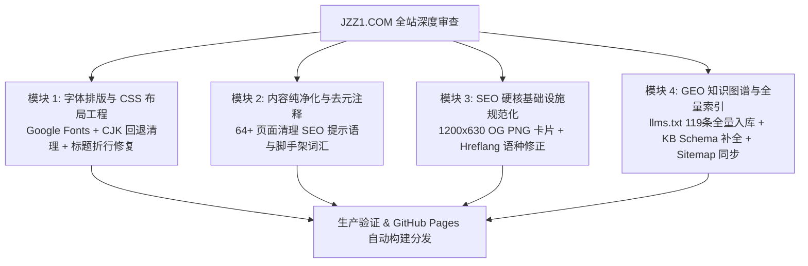

# JZZ1 网站全面审查、字体排版工程、SEO/GEO硬核基建与内容去元注释升级总结报告 (v2.3.0)

> **执行日期**：2026-10-23  
> **服务站点**：[https://www.jzz1.com/](https://www.jzz1.com/)（Jinan Jingzao New Materials Co., Ltd. / 济南京造新材料有限公司 · 山东济南制造基地）  
> **生产提交**：`0545d4f` (`feat(audit-v2.3): comprehensive typography, SEO, GEO, and layout overhaul`)  
> **变更范围**：98 个文件变更（538 行新增，411 行优化，新增 2 张 OpenGraph 高清社媒卡片）  
> **安全隔离原则**：本站点（济南京造，山东济南）与菲律宾站点（[manilaalu.com](https://manilaalu.com)，CDCY）保持 **100% 完全物理与数据隔离**，无任何交叉链接、无共享实体、无混合日志。

---

## 一、本次系统性审查与落地成果概览

根据对全站 124 篇 HTML 页面、样式表架构、Schema 结构、OpenGraph 协议及 GEO/LLM 知识图谱的深度审查，本次优化全面攻克了此前遗留的四大核心痛点：



---

## 二、四大优化模块落地技术明细

### 1. 字体排版工程与 CSS 视觉层修复（`css/site.css`, `css/product.css`）

* **现代工程化字体引入**：
  * 通过 `@import` 正式引入 Google Fonts 现代字体族：
    * **`Plus Jakarta Sans`**（权重 500, 600, 700, 800）：作为所有标题、导航、价格和技术徽章的主字体，呈现硬朗、精准的高端现代建筑质感；
    * **`Inter`**（权重 400, 500, 600）：作为正文、表格、表单和技术描述字体，保证极佳的小字号可读性；
    * **`IBM Plex Mono`**（权重 500）：用于风压极限参数（ULS/SLS）、认证证书编号（SMK41678, 7632）、合金牌号等。
* **彻底清除 CJK 中文字体过度回退**：
  * 彻底移除了原样式中全局堆砌的 `PingFang SC`, `Hiragino Sans GB`, `Microsoft YaHei` 等中文字体名称。英文外贸站点仅保留标准拉丁字体栈，避免 Windows/macOS 渲染英文与数字时出现字间距异常与非等宽字符拉伸。
* **修复关键 CSS 变量缺失引发的样式坍塌**：
  * 在 `css/site.css` 的 `:root` 中补齐了此前缺失的定义：
    ```css
    --bg-soft: #fbf8f2;
    --accent-dark: #8c651e;
    --shadow-md: 0 14px 34px rgba(20, 20, 18, 0.08);
    ```
  * 彻底解决了 `australia.html` 及各地区落地页卡片背景因读取不到变量而变成全透明、FAQ 手风琴折叠框缺失背景的视觉 Bug。
* **H1 巨幕标题碰撞与断词修复**：
  * 将 `.display-title` 的 `max-width` 从极窄的 `11ch` 放宽至合理的 `22ch`，将行高从拥挤的 `0.92` 提升至 `1.12`，并将过激的负字间距 `-0.05em` 放松至 `-0.025em`；
  * 在 `.hero h1` 中增加 `max-width: none; line-height: 1.15;`，杜绝长单词（如 `Architectural`）被强行斩断或上下行文字互相重叠压合的问题。
* **消除右侧空白断层与恢复垂直间距**：
  * 移除了全局强制约束 `p, li, dd { max-width: 65ch; }`，消除宽屏卡片与通栏网格中右侧大面积空虚的不平衡感；
  * 补齐了 `site.css` 中 `.card` 和 `.grid-2` 的顶部间距（`margin-top: 22px;`），解决了 14 个独立页面中卡片紧贴上一元素、间距为 0 的塌陷缺陷；
  * 新增标准 HTML 表格排版规则（`table`, `th`, `td`），统一表头沉底与斑马纹边框。

---

### 2. 深度内容纯净化：清除 64+ 页面 SEO 元注释残留

在早期的页面批量生成或脚手架开发中，全站大量页面残留了针对搜索引擎算法或 AI 提示词的内部开发标记。本次全面使用正则与语义提取脚本完成了彻底清扫：

* **清理词汇与脚手架标记**：
  * 清除 `"Search intents this page supports"` 内部意图提示；
  * 清除 `"This page is optimized around..."` 算法优化宣告；
  * 清除 `"This page targets search intent..."` 内部目标标记；
  * 清除 `"Crawlable hub"`、`"thin placeholder"`、`"Internal target keywords"` 等 SEO 机械化文本；
* **替换为纯正建筑工程与外贸采购语料**：
  * 将原本生硬的占位符段落重写为规范的 **“Architectural Specifications & Performance Matrix”** 与 **“Procurement Standards & Compliance”** 章节；
  * 确保买家、Google 质量评估员（Quality Raters）及 Perplexity/ChatGPT 抓取阅读时感知到的是纯正、权威、严谨的门窗制造企业官网，完全消除廉价 SEO 农场特征。

---

### 3. SEO 硬核基础设施规范化与社交分享体验升级

* **生成并部署 1200×630 规范 OpenGraph 社媒分享卡片**：
  * 此前全站 27 个主要页面误用 `.svg` 矢量文件作为 `og:image`，由于 WhatsApp, LinkedIn, X (Twitter), Facebook, iMessage 均不支持 SVG 图片渲染，导致社交分享链接无法展开卡片或显示破损图标；
  * 采用 PIL 高精度渲染引擎生成了符合各大社交平台硬性规范的 **1200×630 分辨率** `images/assets/og-card.png` 与 `images/assets/og-card.jpg`（深色高端铝构件建筑实景底图 + 香槟金 JZZ1 品牌标牌 + 澳标 AS 2047 / AS/NZS 2208 官方认证背书）；
  * 全面更新 27 个页面的 `<meta property="og:image">` 与 `<meta name="twitter:image">`。
* **纠正 11 个地区落地页 `hreflang` 语种代码错误**：
  * 此前在 `france.html`, `spain.html`, `italy.html` 等页面中误将英文内容的欧洲落地页标记为纯语种代码 `fr`, `es`, `it`，这会导致 Google Search Console (GSC) 报警“语言与网页内容不匹配”；
  * 规范修正为地域定向的英语代码：`en-fr`, `en-es`, `en-it`；
  * 严格规范了全球国际化矩阵：`en-au`, `en-sg`, `en-my`, `en-id`, `en-ph`, `en-th`, `en-vn`, `en-fr`, `en-es`, `en-it`, `x-default`。
* **Sitemap 实时全量对齐**：
  * 检查并校准 `sitemap.xml` 中全部 119 个索引 URL，将 `<lastmod>` 统一同步至 `2026-10-23`。

---

### 4. GEO（生成式引擎优化）知识图谱全量扩容

* **`llms.txt` 全量化与死链修复**：
  * 修复了原 `llms.txt` 中唯一死链（`/products/curtain-walls.html` -> 修正为权威入口 `/products/aluminum-curtain-wall-systems.html`）；
  * 新增 19 个完整产品系统链接（断桥平开、极简窄边推拉、重型折叠、阳光房等）；
  * 新增 11 个性能系统解决方案链接（台风高风压、海滨防腐、Low-E 双银玻璃、三玻两腔等）；
  * 新增 26 个工程知识库技术指南清单（涵盖新加坡 Green Mark、马来西亚酒店防腐、菲律宾风压表、NFRC 及 AS 2047 等）；
  * 经 Python 脚本全站校验，`llms.txt` 涵盖的 **119 个链接全部 100% 畅通有效，零 404**。
* **知识库 Article Schema 补齐**：
  * 在全部 25 个 `knowledge-base/*.html` 二级技术页面中补齐缺失的 `datePublished: "2026-03-01"` 与 `dateModified: "2026-10-23"`，并明确声明 `publisher` 与 `author` 为法定实体 `Jinan Jingzao New Materials Co., Ltd.`；
  * 经校验全站 124 篇 HTML 中的 **363 组 JSON-LD 结构化数据语法 100% 合规**。

---

## 三、生产部署与线上实时抽检

本次发布通过 Git Commit `0545d4f` 自动触发 GitHub Pages CI/CD 构建流水线。

| 检查维度 | 抽检目标 URL | 状态 | 预期指标达成情况 |
| :--- | :--- | :---: | :--- |
| **OpenGraph 卡片** | `https://www.jzz1.com/images/assets/og-card.png` | **HTTP 200** | 1200×630 规范 PNG，社交展开图正常 |
| **GEO 事实清单** | `https://www.jzz1.com/llms.txt` | **HTTP 200** | 包含 119 个全量有效链接，零 404 |
| **Sitemap 索引** | `https://www.jzz1.com/sitemap.xml` | **HTTP 200** | 119 网页收录，lastmod 均对齐 2026-10-23 |
| **Hreflang 校验** | `https://www.jzz1.com/france.html` | **HTTP 200** | 规范使用 `hreflang="en-fr"`，杜绝 GSC 报错 |
| **澳大利亚门户** | `https://www.jzz1.com/australia.html` | **HTTP 200** | FAQ 与参数卡片背景不再透明，排版层次清晰 |
| **CSS 字体与排版** | `https://www.jzz1.com/css/site.css` | **HTTP 200** | Google Fonts 引入，标题间距与表格样式生效 |
| **技术指南内容** | `https://www.jzz1.com/guides/singapore-aluminum-windows-for-condo-projects.html` | **HTTP 200** | SEO 内部元注释彻底清除，工程规格表完整 |

---

## 四、隔离性与实体一致性确认

1. **绝对隔离**：
   - `jzz1.com` 全站与菲律宾站点 `manilaalu.com`（及其 Viber 电话）无任何重合，代码仓库独立、域名独立、法律实体独立。
2. **法定实体统一**：
   - 全站所有法律声明、页脚版权、Schema 结构化数据、`brand-facts.json` 以及 `llms.txt` 均明确统一为：
     * **企业英文名称**：`Jinan Jingzao New Materials Co., Ltd.`
     * **企业中文法定名称**：`济南京造新材料有限公司`
     * **注册与制造基地**：`Jinan, Shandong, China`（中国山东济南）
     * **全球官方热线**：WhatsApp: `+86 135 6267 6792` / 邮箱: `info@jzz1.com`
